<p align="center">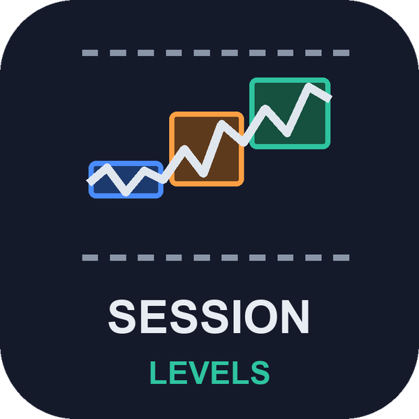</p>

# Session Levels (MetaTrader 5 and MetaTrader 4)

A free indicator that draws the **Asia, London and New York session boxes**, the **previous day and previous week high and
low** and **today's open**, with session times entered in **New York time** and converted from your broker's clock, so
daylight saving is right on any broker. It alerts when a closed bar breaks the previous day or the Asia range. Source for both
editions, a Python reference of the rules, and the tests that were used to check that MT5, MT4 and Python all agree.

**Website:** [allanninal.dev/mql5 (indicators)](https://www.allanninal.dev/mql5/#indicators) · [MT4 editions](https://www.allanninal.dev/mql5/#mt4) · [allanninal.dev](https://www.allanninal.dev)
· **Contact:** message me on [LinkedIn](https://www.linkedin.com/in/allanninal/).

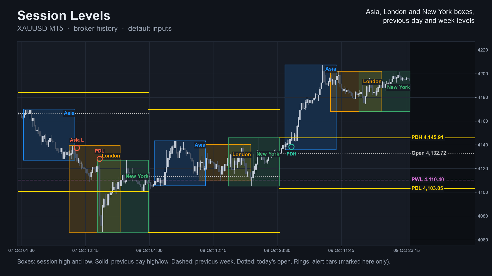

> It shows levels, not entries. It places no trades and gives no buy or sell advice. Nothing here is a profit claim
> (see [Honest limits](#honest-limits)).

## Get it on the MQL5 Market

| Edition | Platform | Price | Link |
|---|---|---|---|
| Session Levels | MT5 | free | <https://www.mql5.com/en/market/product/201881> |
| Session Levels MT4 | MT4 | free | <https://www.mql5.com/en/market/product/202384> |
| SMC Session Scanner MT5 | MT5 | paid | <https://www.mql5.com/en/market/product/201879> |
| SMC Session Scanner MT4 | MT4 | paid | <https://www.mql5.com/en/market/product/202425> |

The Market builds are the same calculation as the source in this repository. The scanner is a separate, paid product that
is **not** part of this repository (see [Free vs Pro](#free-vs-pro)).

## Contents

1. [What it is and who it is for](#what-it-is-and-who-it-is-for)
2. [Why it was built](#why-it-was-built)
3. [How it works](#how-it-works)
4. [Non-repainting: the proof and how it was tested](#non-repainting-the-proof-and-how-it-was-tested)
5. [Architecture and buffers](#architecture-and-buffers)
6. [Inputs, alerts, install and compile](#inputs-alerts-install-and-compile)
7. [Run the Python reference and the tests](#run-the-python-reference-and-the-tests)
8. [Honest limits](#honest-limits)
9. [Free vs Pro](#free-vs-pro)
10. [Licence](#licence)

## What it is and who it is for

**What:**

- Three **session boxes** (Asia 19:00 to 04:00, London 03:00 to 12:00, New York 08:00 to 17:00, New York time). The box edges
  are the session high and low; the current session grows live.
- **Previous day high and low** (solid), **previous week high and low** (dashed) and **today's open** (dotted), as lines per
  day; on the current day they run to the right edge with price labels.
- **Alerts** on closed bars: a close above the previous day high, below the previous day low, and, after the Asia session,
  above its high or below its low. Each kind at most once per trading day.
- Sessions and the open on M1 to H4; above H4 only the previous day and week levels.

**For:** traders who mark session ranges and daily or weekly levels by hand and want them drawn automatically, correctly
shifted for their broker and for daylight saving, on any symbol. Also for developers: seven documented buffers for `iCustom`.

**Not for:** anyone who wants buy and sell arrows or an automatic system. This is a level map.

| | |
|---|---|
| 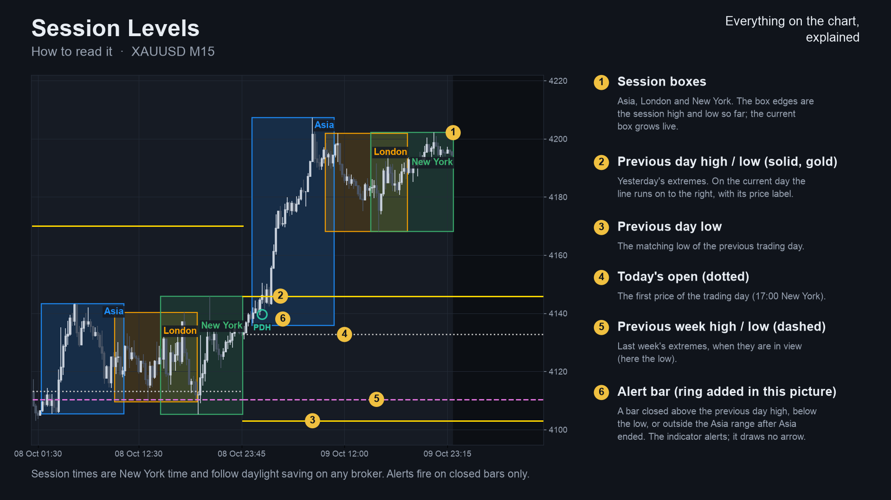 | 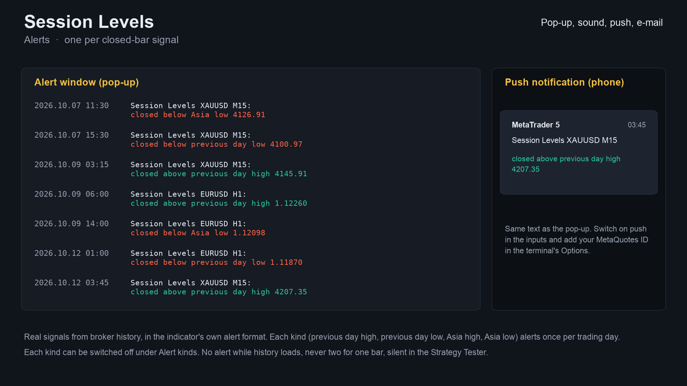 |
| 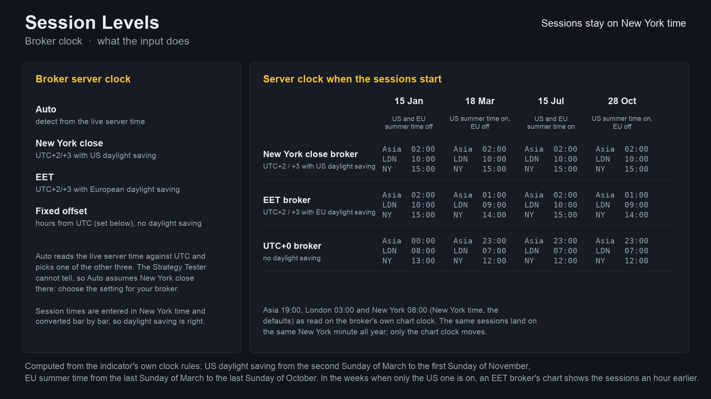 | 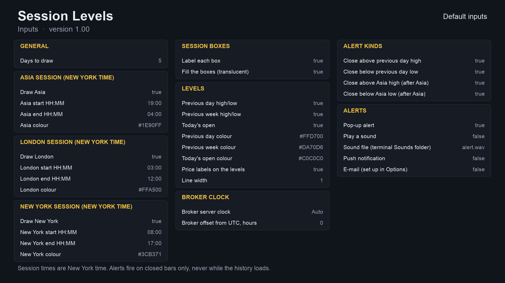 |

Image notes: charts are drawn by the Python reference on broker history (the same numbers the indicator shows); the alert text
is the indicator's real text but the pop-up and phone card around it are mock-ups; the Data Window panel is a mock-up of the
buffer map. They are illustrations, not terminal captures. More images, including the MT4 versions, are in
[`docs/images/`](docs/images).

## Why it was built

Session boxes and previous-day levels are among the most hand-drawn things on a chart. The reasons, with the evidence we have:

- **Brokers differ in clock and daylight saving.** A box that says "London 03:00 to 12:00" is only right if the indicator
  knows whether your server is on a New York close, EET or a fixed offset, and which weeks each side has shifted. The point
  of this indicator is to get that right and to say how.
- **Demand is steady but small-ticket.** On the MQL5 Freelance board, 72 of 2,014 scraped jobs (Nov 2025 to Oct 2026) were
  about session logic (Asian range, killzones, session breakouts); typical budgets are 30 to 100 USD. Free session tools
  already sit in the Market's top lists, so this is a free reference, not a claim of a gap.
- **Provable behaviour.** Alerts use closed bars only and every number here comes from an executed check.

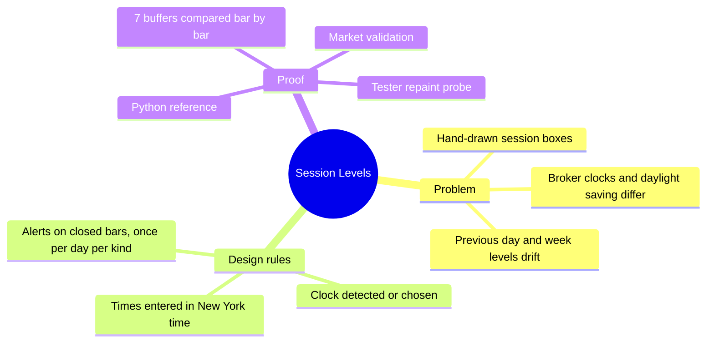

## How it works

### The rules, step by step

1. **Broker clock to New York time.** A trading day runs from 17:00 to 17:00 New York time. Each bar's broker time is
   converted with one of four clocks: *Auto* (compares the live server time with UTC and picks one of the others; in the
   Strategy Tester it cannot tell and assumes New York close), *New York close* (UTC+2 / +3 with US daylight saving),
   *EET* (UTC+2 / +3 with European daylight saving) or a *fixed offset*. US daylight saving runs from the second Sunday of
   March to the first Sunday of November; European from the last Sunday of March to the last Sunday of October. In the
   weeks when only one side has shifted, an EET broker's chart shows the sessions an hour earlier.
2. **Sessions.** A bar belongs to a session by its **open time**. A session that crosses midnight (Asia) belongs to the
   trading day it ends on. Box edges are the highest high and lowest low so far.
3. **Previous day and week.** The previous trading day's high and low, and the previous Monday-based week's. The first day and
   week in the data have no "previous". On D1 and above the day and week are built from the chart's own bars.
4. **Today's open** is the first price of the trading day (17:00 New York).
5. **Signals** (buffer 6, closed bars only, each kind at most once per trading day): `+1` the first close above the previous
   day high, `-1` the first close below the previous day low, `+2` the first close above the Asia high after Asia ended, `-2`
   the first close below the Asia low. If two kinds fire on one bar the priority is: previous day high, previous day low,
   Asia high, Asia low.

### Per-bar algorithm

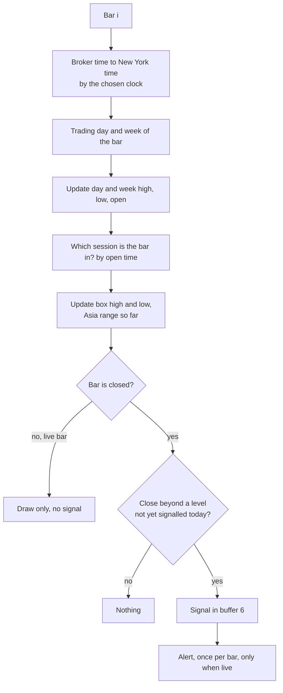

### Trading-day states

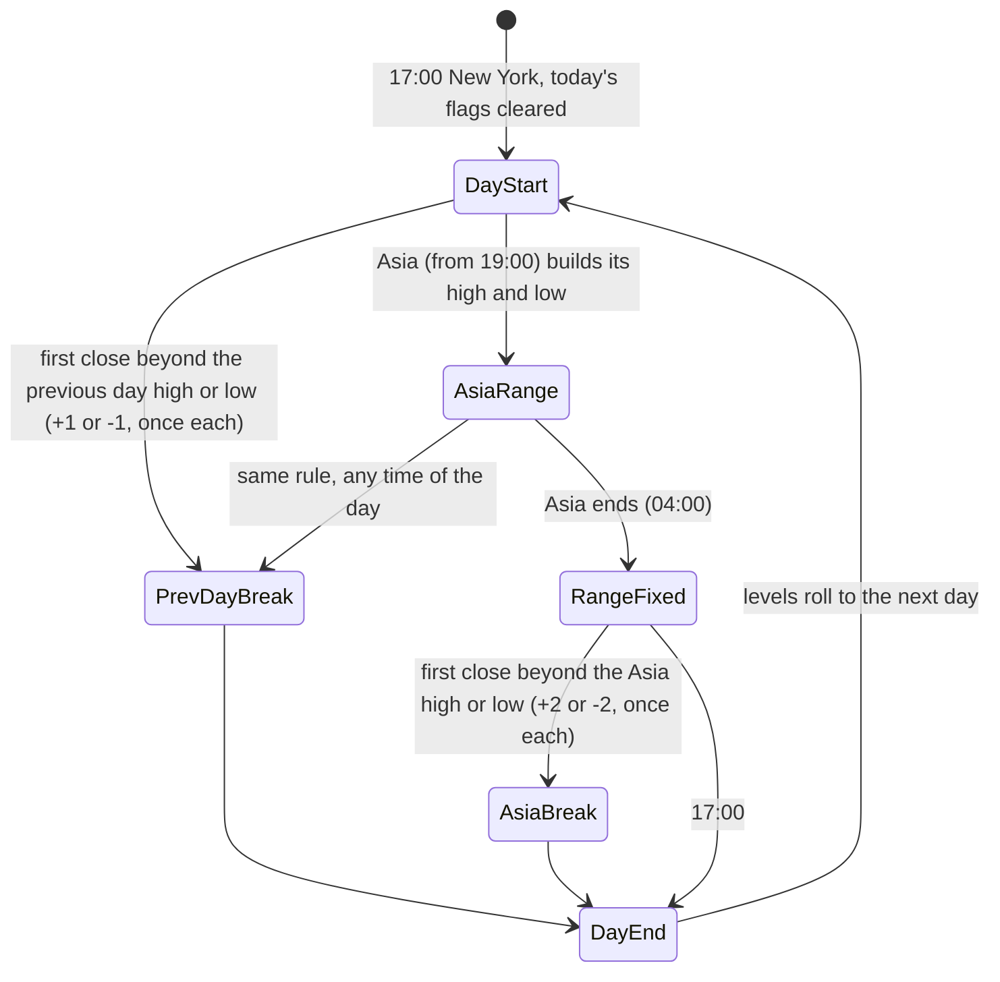

### Alert flow

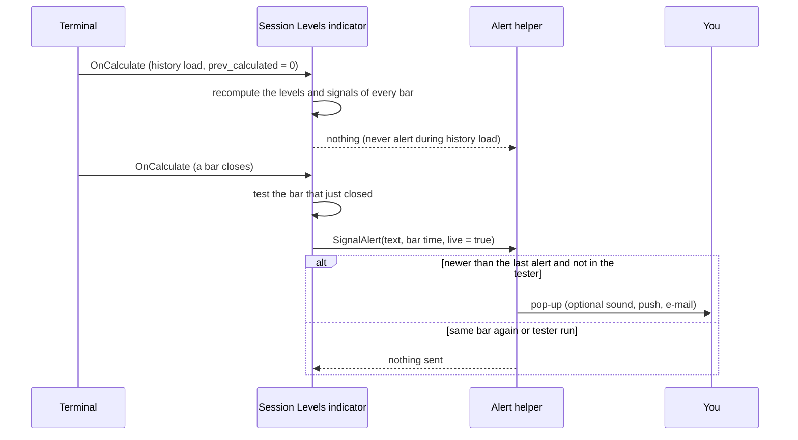

### How many signals each timeframe gives (measured)

Signal values (buffer 6) over the same XAUUSD history with default inputs. Source:
[`tests/results/parity-mt5.txt`](tests/results/parity-mt5.txt). This counts signals only; it says nothing about whether
breaking a level is worth trading.

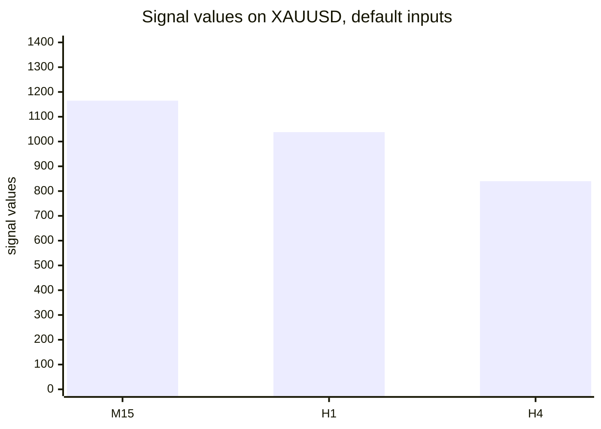

Coarser bars give fewer signals because several breaks can share one bar and each kind fires once per day.

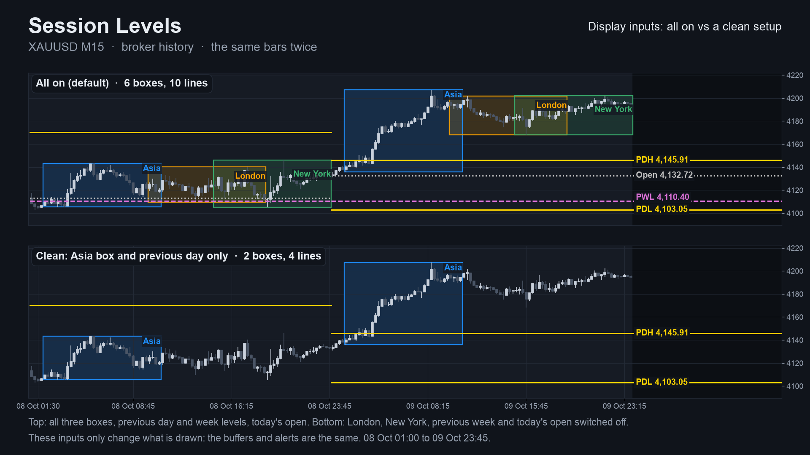

## Non-repainting: the proof and how it was tested

"Non-repainting" is easy to claim. Here is what was actually run. Raw result files are in [`tests/results/`](tests/results).

**1. Three implementations, compared bar by bar.** The Python reference ([`tests/reference.py`](tests/reference.py)) was written
from the rules above, not from the MQL code. The MT5 and MT4 indicators were dumped bar by bar (7 buffers) in the MetaTrader
Strategy Tester and [`tests/check_parity.py`](tests/check_parity.py) compared each dump with the reference. Pass means: on
every closed bar all seven buffers match (levels within 1e-9 relative, signals exactly, blank where the reference is blank).

| | MT5 | MT4 |
|---|---|---|
| dumps compared | 24 (4 symbols x M15/H1/H4 x 2 input sets) | 25 (the same 24 + one every-tick EURUSD H1) |
| bars compared | 652,332 | 509,573 |
| signal values compared | 24,804 | 19,342 |
| result | ALL PASS | ALL PASS |

Symbols: EURUSD, XAUUSD, GBPJPY, BTCUSD. Input sets: defaults; London 02:00 to 05:00 and New York 07:00 to 10:00 ("kill
zones"). The test server uses a New York close clock, which the reference assumes (see [Honest limits](#honest-limits)).
Sources: [`tests/results/parity-mt5.txt`](tests/results/parity-mt5.txt), [`tests/results/parity-mt4.txt`](tests/results/parity-mt4.txt).
The MT4 test history is shorter on the FX pairs, which is why the bar counts differ.

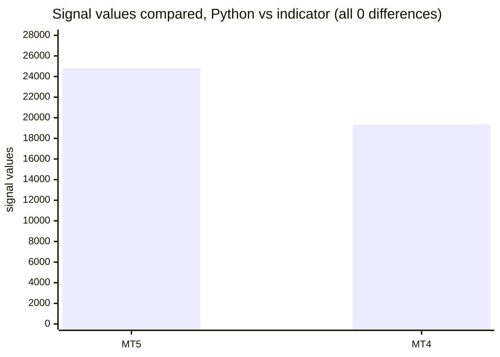

**2. Repaint probe.** A probe records the signal buffer on each bar *at the moment it closes*, then reads the same bars again at
the end and counts any value that changed. It also counts any signal ever shown on the still-forming bar.

| Run | Closed bars checked | Signals seen at close | Changed afterwards | Signals on the live bar |
|---|---|---|---|---|
| MT5, EURUSD H1, every tick, 10,411,052 ticks | 4,644 | 345 | **0** | **0** |
| MT4, 25 runs combined | 506,172 | 19,020 | **0** | **0** |

Source: [`tests/results/repaint-summary.md`](tests/results/repaint-summary.md). The MT5 probe ran once (EURUSD H1, default
inputs); the MT4 probe ran on every dump run.

**3. Market validation.** Both Market builds passed the MQL5 Market's automated product validation before publication (the
Market's own check, not part of this repository).

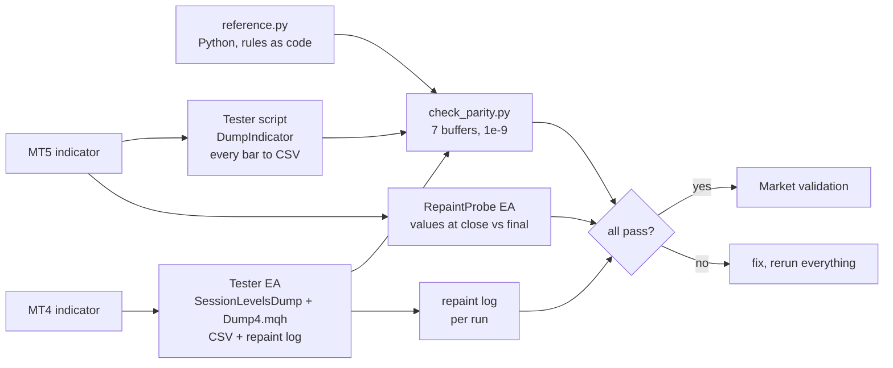

### Why the design cannot repaint

- Signals are written only for closed bars; the forming bar's signal buffer is empty.
- A level of the previous day or week never changes once that day or week is over. A box edge of a session in progress does
  move as price moves; that is the drawing of the live session, not a signal.
- Each signal kind fires at most once per trading day, and alerts fire only for the bar that just closed, after the history
  load, once per bar, and never in the tester.

## Architecture and buffers

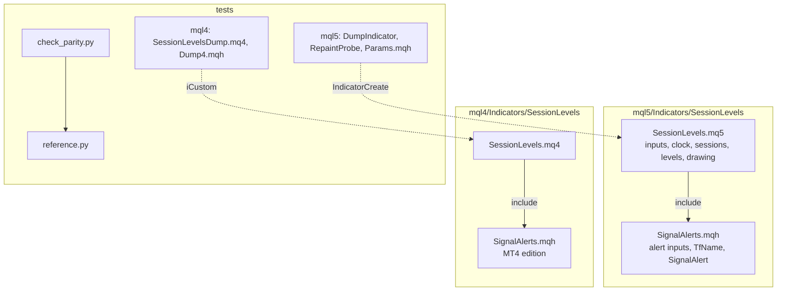

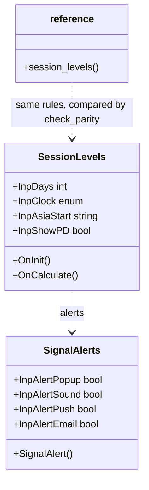

### `iCustom` buffer table (for EA developers)

| Buffer | Content |
|---|---|
| 0 | previous day high |
| 1 | previous day low |
| 2 | previous week high |
| 3 | previous week low |
| 4 | Asia high so far (the current trading day's Asia session; empty before it starts) |
| 5 | Asia low so far |
| 6 | signal: +1 close above previous day high, -1 below previous day low, +2 above the Asia high, -2 below the Asia low |
| 7 to 19 | internal calculation buffers |

Empty value is `EMPTY_VALUE`. Read **closed bars** (shift 1 and higher). `iCustom` parameters follow the input order; in MT5
the `input group` headings also count as string parameters when you build a handle with `IndicatorCreate` (see
`tests/mql5/Include/IndTest/Params.mqh`). In MT4 the same seven buffers are available; a filled box is the session colour
blended into the chart background (MT4 has no translucency).

## Inputs, alerts, install and compile

| Input | Default | Meaning |
|---|---|---|
| Days to draw | 5 | Days that get boxes and lines |
| Draw Asia / London / New York | true | Per-session switch, each with its own start, end (HH:MM New York time) and colour |
| Session times | Asia 19:00-04:00, London 03:00-12:00, New York 08:00-17:00 | New York time |
| Label each box / Fill the boxes | true / true | Box text and fill |
| Previous day / previous week / today's open | true | Levels, each with a colour |
| Price labels on the levels / Line width | true / 1 | Appearance |
| Broker server clock | Auto | Auto, New York close, EET or Fixed offset |
| Broker offset from UTC, hours | 0 | Fixed offset only |
| Alert kinds | all four on | Previous day high / low, Asia high / low |
| Pop-up / sound / push / e-mail | true / false / false / false | Delivery (push needs your MetaQuotes ID) |

An alert reads, for example, `Session Levels EURUSD M15: closed above previous day high 1.0850`.

**Install from source.** Copy `mql5/Indicators/SessionLevels/` into `<terminal data folder>/MQL5/Indicators/` (MT5) or
`mql4/Indicators/SessionLevels/` into `<data folder>/MQL4/Indicators/` (MT4), open `SessionLevels.mq5` or `.mq4` in MetaEditor
and press Compile (F7). Both compile with 0 errors (checked with the MetaEditor of a MetaTrader 5 and a MetaTrader 4 build on
a Windows machine; the compiled files are not in the repository). Keep the two files of each edition together.

## Run the Python reference and the tests

```bash
python3 -m venv .venv && . .venv/bin/activate && pip install -r requirements.txt
```

```python
import sys; sys.path.insert(0, "tests")
from reference import session_levels
# t (epoch seconds, server time), o, h, l, c: arrays of bars, oldest first; the last bar is the live bar.
# Assumes a New York close server clock (server = New York + 7 h). Returns an (n, 7) array: the seven buffers.
out = session_levels(t, o, h, l, c, asia_start="19:00", asia_end="04:00")
```

To repeat the parity check on your own data:

1. Compile the indicator and the test tool for your platform (`tests/mql5/Scripts/DumpIndicator`, or
   `tests/mt4/SessionLevelsDump.mq4` with `tests/mql4/Include/IndTest4/Dump4.mqh` in your `MQL4/Include/IndTest4/`; MT5 also
   needs `tests/mql5/Include/IndTest/Params.mqh`).
2. Run it for each symbol and timeframe with the input sets in `tests/configs.tsv` (MT5) or `tests/mt4/configs.tsv` (MT4), on
   a server whose clock is New York close. Each run writes one CSV per symbol and timeframe.
3. `python3 tests/check_parity.py <folder with the CSVs>` (add `--mt4` for MT4 dumps). It prints PASS or FAIL per file.
4. Repaint: run `tests/mql5/Experts/RepaintProbe` in the MT5 Strategy Tester (every tick); MT4 writes its repaint log with the dump.

The price dumps used for the published numbers are not in this repository (they are broker price data).

## Honest limits

- **Levels, not entries.** A previous-day break is a fact about a close, not a prediction. No profit or accuracy claim is made;
  the numbers are about *consistency* and *frequency*.
- **The parity tests cover one clock.** The Python reference assumes a New York close server clock, and the test server had
  one. The other clocks (EET, fixed offset, Auto) follow the stated daylight-saving rules but were not compared against the
  reference. In the Strategy Tester, Auto cannot detect the clock and assumes New York close, so choose it yourself there.
- **Sessions are conventions.** Session hours are the defaults above; change them if you use others.
- **A session box in progress moves** as price moves; only alerts and the signal buffer are closed-bar facts.
- **Above H4** only the previous day and week levels are drawn; on D1 and above they are built from the chart's own bars.
- **Scope of the tests.** Four symbols, three timeframes, two input sets, one MT5 repaint run. Other symbols, timeframes and
  settings are not covered by the published numbers. The MT5 build was not run on a live chart as part of these numbers.
- A scanner that watches structure and these session levels across many symbols exists as a separate paid product (see below).

## Free vs Pro

| | Free: Session Levels | Paid: SMC Session Scanner |
|---|---|---|
| Platforms | MT5 [201881](https://www.mql5.com/en/market/product/201881), MT4 [202384](https://www.mql5.com/en/market/product/202384) | MT5 [201879](https://www.mql5.com/en/market/product/201879), MT4 [202425](https://www.mql5.com/en/market/product/202425) |
| Price | free | paid (see the Market page) |
| What you get | Session boxes, previous day and week levels, today's open, alerts on the current chart, source here | A multi-symbol, multi-timeframe scanner panel, as described on its Market listing |
| Source | this repository | not published |
| Closed-bar alerts | yes | see its listing |

No need to buy the paid product to use the free one: the free indicator is complete on its own.
Website: [allanninal.dev/mql5](https://www.allanninal.dev/mql5/#indicators) ([MT4](https://www.allanninal.dev/mql5/#mt4)).

## Licence

Everything is © 2026 Allan Niñal under the
[PolyForm Noncommercial License 1.0.0](LICENSES/PolyForm-Noncommercial-1.0.0.md): source-available, free for personal and
other noncommercial use, not for commercial use. Each source file has an `SPDX-License-Identifier` line; the text is in
[`LICENSE`](LICENSE). The licence applies to this source, not to anything you build or trade with the indicator. Trading
involves risk; the software is provided as is.

---

**Website:** [allanninal.dev/mql5](https://www.allanninal.dev/mql5/#indicators) · [MT4](https://www.allanninal.dev/mql5/#mt4) · [allanninal.dev](https://www.allanninal.dev)
· Questions: message me on [LinkedIn](https://www.linkedin.com/in/allanninal/).
